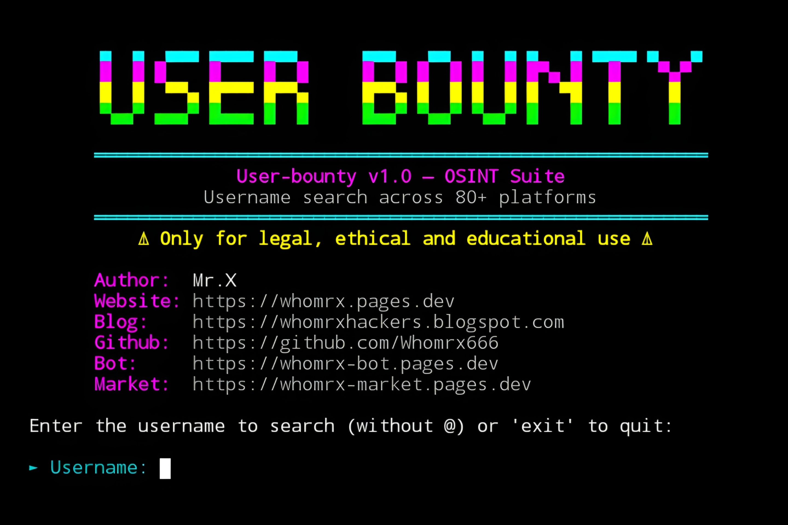

# User-bounty v1.0


<p align="center">
  <strong>OSINT Suite – Search Usernames Across 80+ Platforms Simultaneously</strong><br>
  <em>"One username. Infinite digital traces." – Mr.X</em>
</p>

## Introduction
User-bounty v1.0 is a powerful OSINT tool that searches a single username across **80+ online platforms** simultaneously. It uses advanced detection techniques (HTTP status codes, content analysis, fallback checks) to determine whether a profile exists. The tool covers social networks, development platforms, gaming communities, music/creator sites, cybersecurity forums, crypto/finance, and more. With multithreaded scanning, a cyberpunk neon interface, and Google dork generation, User-bounty is ideal for digital footprinting, investigations, and ethical OSINT research. It runs smoothly on **Termux (Android)**, Linux, Windows, and macOS—**no root required**.

## Installation
```bash
$ pkg update -y && pkg upgrade -y
$ pkg install git python -y
$ pip install requests colorama
$ git clone https://github.com/Whomrx666/User-bounty.git
$ cd User-bounty
$ python3 install.py
```

## Run manually
```bash
$ python3 user-bounty.py
```

## Features
- **80+ Platforms** – Social networks, developer sites, gaming, music, cybersecurity, crypto, and more.
- **Multithreaded Scanning** – Up to 20 concurrent requests for speed.
- **Advanced Detection** – Uses HTTP status, content analysis (`contains:`/`not_contains:`), and fallback URLs.
- **Category Grouping** – Results organized into logical categories (Social, Dev, Gaming, etc.).
- **Google Dorks** – Automatically generates 10 Google dork links for deeper investigation.
- **Detailed Summary** – Shows target, platforms analyzed, profiles found, and elapsed time.
- **Cyberpunk UI** – Neon banner, loading animation, progress bars, and colored output.
- **Input Validation** – Cleans `@` and validates username characters.
- **No Root Required** – Runs entirely with standard Python libraries.
- **Educational Use** – Designed for authorized OSINT research only.

## Supported Platform Categories
| Category | Example Platforms |
|----------|-------------------|
| Social Networks | Instagram, Twitter/X, TikTok, Facebook, LinkedIn, Pinterest, Snapchat, Reddit, Threads, Bluesky |
| Development / Tech | GitHub, GitLab, Bitbucket, HackerNews, StackOverflow, Dev.to, Replit, Kaggle, NPM, PyPI |
| Gaming | Steam, PSN, Roblox, Chess.com, Minecraft, Fortnite, Speedrun |
| Music / Creators | Spotify, SoundCloud, Bandcamp, Last.fm, Mixcloud, YouTube, Twitch, Kick, Vimeo |
| Photos / Design | Flickr, Behance, Dribbble, DeviantArt, ArtStation |
| Cybersecurity | HackTheBox, TryHackMe, BugCrowd, HackerOne |
| Crypto / Finance | Keybase, CoinMarketCap, CashApp |
| Work / Professional | ProductHunt, Fiverr |
| Communities | Quora, Medium, Substack, WordPress, Goodreads, Letterboxd |
| Others | Telegram, Gravatar, About.me, Linktree, Patreon, Ko-fi, Strava |

*Note: The tool includes 80+ platforms in total. See the script source for the full list.*

## Menu Options
The tool is interactive and prompts for a username, then automatically scans all platforms. There is no numbered menu; instead, after the scan, you can:

- **Search another username** – Press Enter to continue, or type `exit` to quit.
- **View Google Dorks** – Automatically displayed after results.
- **Exit** – Type `exit`, `quit`, or `q` at any prompt.

## Instructions
1. **Install** the tool using the commands above.
2. **Run** `python3 user-bounty.py` to start.
3. **Enter a username** when prompted (without `@`).
4. **Wait for the scan** – 80+ platforms are checked in parallel.
5. **Review results** – Found profiles are grouped by category with URLs.
6. **Explore Google Dorks** – Use the generated search links for deeper investigation.
7. **Search again or exit** – Press Enter to continue or type `exit` to quit.

## Observation
This tool is intended for **educational and authorized OSINT research purposes only**. Always respect privacy, obtain proper authorization, and comply with applicable laws and platform terms of service. Misuse may violate regulations and lead to legal consequences. The author assumes no responsibility for any misuse or damage caused by this tool.

### Original Author
<a href="https://github.com/Whomrx666"></a>

### <<< If you copy, then give me the credits >>>

## CONNECT WITH ME :

[](https://whomrx.pages.dev)
[](https://whomrxhackers.blogspot.com)
[](https://twitter.com/whomrx666)
[](https://wa.me/6285926601133?text=Halo%2C%20Mr.X)
[](https://www.facebook.com/whomrx.666)
[](https://t.me/Whomr_X)
[](mailto:whomrx666@gmail.com)
[](https://www.tiktok.com/@whomr.x)

**If you want to donate, click on the button**
<a href="https://saweria.co/whomrx"></a>

---

<p align="left">
  
</p>